# AccordOps AI

**Python-first AI automation for contract operations.** AccordOps turns signed contractual commitments into human-reviewed operational controls, monitors real evidence through n8n, investigates potential breaches with Gemini (or transparent Python local rules), and executes only human-approved remediation with a complete audit trail.

## Why this project exists

Important SLA, billing, renewal, notice and deliverable commitments often remain buried in PDFs while operational evidence lives in service systems, CRMs, billing platforms, email and workflow tools. AccordOps creates a control loop between the contract and day-to-day operations.

## End-to-end product flow

```mermaid
flowchart LR
    A[Contract PDF/DOCX] --> B[Python / FastAPI ingestion]
    B --> C[Gemini or Python control extraction]
    C --> D[Human obligation review]
    D --> E[Approved operational control]
    E --> F[n8n evidence webhook]
    F --> G[Normalize + fetch Python control context]
    G --> H[Gemini compliance evaluation]
    H --> I{Compliant?}
    I -->|Yes| J[Record evidence + audit]
    I -->|No| K[Exception + investigation]
    K --> L[Human approval gate]
    L --> M[n8n approved remediation]
    M --> N[Action result + audit trail]
```



## Technology roles

- **Python / FastAPI:** domain API, tenant isolation, authorization, PDF/DOCX processing, hashing/deduplication, structured control extraction, local confidence scoring, persistence, monitoring callbacks, approval orchestration, audit generation, tests.
- **n8n:** operational evidence ingestion, normalization, API orchestration, Gemini call, conditional routing and approved-remediation execution.
- **Gemini:** semantic contract extraction and compliance reasoning when configured.
- **Supabase:** authentication, PostgreSQL data model and private contract storage.
- **Next.js / TypeScript:** responsive operator interface and public product entry page.

## Real n8n workflows

The repository contains two importable workflows:

- `n8n/accordops-operational-evidence-monitor.json`
- `n8n/accordops-approved-remediation.json`

They are designed to be imported into the local n8n instance, activated, executed, and inspected from n8n's execution history.

See **[docs/N8N_SETUP.md](docs/N8N_SETUP.md)**.

## Local extraction is honest about what it is

When `GEMINI_API_KEY` is absent, AccordOps uses deterministic Python control extraction. It does **not** label that output as AI. Extraction confidence is computed from clause quality signals such as explicit obligation language, responsible party, measurable threshold, timing/trigger clarity and ambiguity.

When Gemini is configured, the backend preserves provider and model metadata for traceability while the product UI stays focused on the contract decision itself.

## Quick start

Prerequisites: Python 3.11+, Node.js 22+, Docker Desktop, Supabase project.

```powershell
cd G:\Projects\AccordOps_AI
powershell -ExecutionPolicy Bypass -File .\scripts\bootstrap.ps1
powershell -ExecutionPolicy Bypass -File .\scripts\validate.ps1
```

Then configure n8n:

```powershell
powershell -ExecutionPolicy Bypass -File .\scripts\prepare-n8n.ps1
docker compose up -d
```

Import and activate both JSON workflows in `http://localhost:5678`, then start the application:

```powershell
powershell -ExecutionPolicy Bypass -File .\scripts\start-dev.ps1
```

- Product / landing page: `http://localhost:3000`
- Workspace: `http://localhost:3000/dashboard`
- API docs: `http://localhost:8000/docs`
- n8n: `http://localhost:5678`

## Database migrations

Apply migrations in order through Supabase SQL Editor:

1. `001_initial_schema.sql`
2. `002_contract_storage.sql`
3. `003_contract_ingestion_integrity.sql`
4. `004_product_v2_identity.sql`

Migration 004 keeps the same user/organization relationship, replaces temporary demo naming with **Northstar Services**, and neutralizes the legacy MVP's fixed 62% confidence records.

For a completely clean portfolio demo, an **optional destructive** cleanup script exists at `supabase/scripts/reset_sample_workspace.sql`.

## Portfolio demo

Use:

`docs/samples/Northstar_Managed_Services_Agreement.docx`

Recommended story:

1. Upload contract.
2. Extract obligations.
3. Review the normalized obligation separately from its source clause and confidence signals.
4. Approve a measurable SLA control.
5. Run an evidence check from **Exceptions**.
6. Watch the **Operational Evidence Monitor** execute in n8n.
7. Review the AI investigation and approval request.
8. Click **Approve & execute**.
9. Watch the **Approved Remediation** workflow execute in n8n.
10. Show the resulting business-readable **Audit Trail** and **Operations Status** page.

See **[docs/PORTFOLIO_DEMO.md](docs/PORTFOLIO_DEMO.md)**.

## Security / control decisions

- No public signup; workspaces are organization-managed.
- Backend derives organization context from the authenticated profile rather than trusting a browser-supplied tenant ID.
- Originals stay in a private Supabase Storage bucket.
- Exact duplicate document uploads are blocked with SHA-256 hashing.
- External remediation is gated by explicit human approval.
- n8n callbacks use a shared automation secret.
- Expired frontend sessions refresh once and otherwise redirect to sign-in instead of surfacing raw token errors.

## Repository status

This project intentionally preserves its incremental Git history: foundation → database/auth → application shell → FastAPI → private storage → contract intelligence → AI automation → product hardening.
