# 🧠 AccordOps AI — AI-Powered Contract Intelligence & Operational Control

**AccordOps AI** is an AI-powered contract intelligence and operational control platform that turns signed agreements into monitored business obligations.

It extracts contractual commitments, keeps them linked to their source evidence, allows teams to review what should actually be monitored, evaluates operational results against approved obligations, detects exceptions, supports AI-assisted investigation, and routes corrective actions through human approval before execution.

`Next.js` • `FastAPI` • `Supabase` • `Gemini` • `n8n` • `Docker`

---

## 📌 Overview

Contracts often contain operational commitments such as service-level targets, reporting deadlines, incident-response timelines, renewal conditions, billing terms, and delivery obligations.

The challenge is not simply reading those contracts. The real difficulty is turning written commitments into controls that can be reviewed, monitored, compared with actual business evidence, and acted on when something goes wrong.

AccordOps connects that lifecycle in one system: **contract ingestion → AI-assisted obligation extraction → human verification → evidence monitoring → exception detection → investigation → approval → controlled remediation → auditability**.

---

## 💡 Why AccordOps

### The Operational Problem

Once a contract is signed, important obligations often remain buried inside PDFs or DOCX files. Teams then depend on spreadsheets, reminders, manual checks, or individual knowledge to remember what must happen and when.

That creates a gap between **what the contract requires** and **what the business is actually doing**. Missed SLA targets, delayed reports, incident-notification breaches, renewal deadlines, or other contractual exceptions may only become visible after the impact has already occurred.

### The AccordOps Approach

AccordOps turns static contractual commitments into **reviewable operational controls**.

AI helps identify and normalize obligations, but extracted results are not treated as automatically authoritative. A human reviewer decides which obligations become active controls. Operational evidence can then be checked against those approved requirements.

When a material variance is detected, AccordOps creates an exception, supports investigation, proposes a corrective action, places that action behind a human approval gate, and records the result of approved remediation.

The result is a single workflow connecting **documents, AI reasoning, operational evidence, human decisions, automation, and audit history**.

---

## ✨ Key Features

### 📄 Contract Intelligence

- Upload and manage contract documents in **PDF** and **DOCX** formats.
- Store contract files in private Supabase storage.
- Parse document content for downstream analysis.
- Extract operational obligations with AI.
- Normalize obligations into structured, reviewable controls.
- Preserve source evidence so every extracted obligation can be checked against the original clause.
- Calculate extraction confidence from available evidence and rule completeness.
- Prevent duplicate contract ingestion using document hashing.

### ✅ Human-Reviewed Controls

- Extracted obligations begin as **candidates**, not active controls.
- Review normalized obligations alongside their source evidence.
- Approve or reject individual obligations.
- Track obligation type, risk, status, and monitoring rule.
- Only approved obligations enter the active monitoring process.

### 📊 Evidence Monitoring

- Select an approved obligation and submit real operational evidence.
- Capture observed outcomes together with supporting context.
- Evaluate actual performance against the approved contractual requirement.
- Support measurable checks such as availability percentages, response times, delivery deadlines, reporting windows, and similar controls.
- Separate compliant outcomes from potential contractual variances.

### ⚠️ Exception & Investigation Management

- Create exceptions when monitored evidence falls outside the approved requirement.
- Preserve the affected obligation, finding, severity, and evidence context.
- Support AI-assisted investigation of the detected variance.
- Generate a recommended corrective action for review.
- Keep resolved exceptions visible for operational history instead of removing them from view.

### 🤝 Human Approval & Controlled Remediation

- Route proposed corrective actions into a dedicated decision queue.
- Allow authorized reviewers to approve or reject remediation.
- Prevent corrective automation from running before approval.
- Pass approved actions into the remediation workflow.
- Return execution results to AccordOps and update the operational record.

### 📈 Operational Visibility & Auditability

- Monitor active contracts, approved controls, open exceptions, and pending approvals.
- Review recent exceptions and operational activity from the Control Center.
- Use **Operations Status** to understand monitoring coverage, current issues, pending decisions, and recent corrective activity.
- Maintain a chronological Audit Trail covering important system events and decisions.
- Keep the interface focused on business outcomes rather than exposing unnecessary implementation details to end users.

---

## 🔄 How AccordOps Works

```text
Contract Upload
      ↓
Document Parsing
      ↓
AI Obligation Extraction
      ↓
Human Review
      ↓
Approved Operational Control
      ↓
Operational Evidence
      ↓
Compliance Evaluation
      ↓
Compliant? ──────────────── Yes ──→ Record Result
      │
      No
      ↓
Exception Creation
      ↓
AI-Supported Investigation
      ↓
Recommended Corrective Action
      ↓
Human Approval
      ↓
Approved? ──────────────── No ───→ Stop / Reject
      │
      Yes
      ↓
n8n Remediation Workflow
      ↓
Execution Result
      ↓
Audit Trail
```

The key principle is **human-in-the-loop control**. AI supports extraction, interpretation, and investigation, while important state changes and corrective actions remain reviewable and approval-gated.

---

## 🖥️ Product Walkthrough

### Contract Register

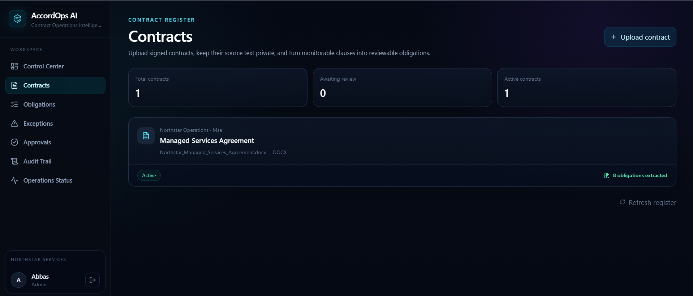

The Contract Register provides a structured view of uploaded agreements, their status, customer context, document information, and extracted-obligation count.

### AI-Extracted Obligations

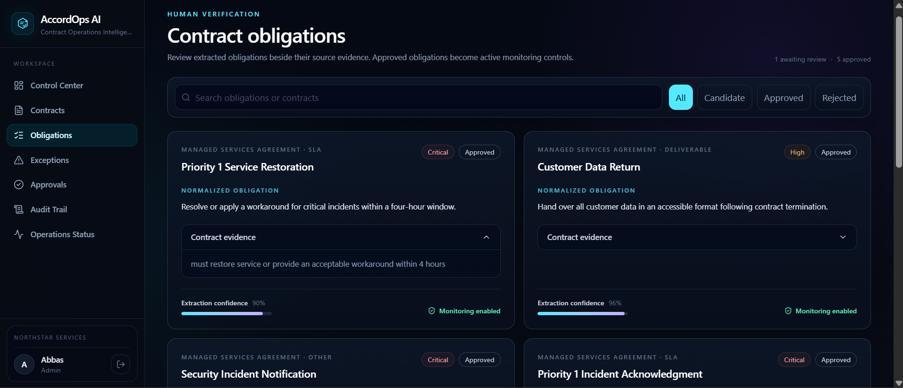

Contract clauses are converted into normalized operational obligations while keeping the original contract evidence available for verification. Reviewers can inspect confidence, risk, rule details, and source context before approving a control.

### Evidence Monitoring

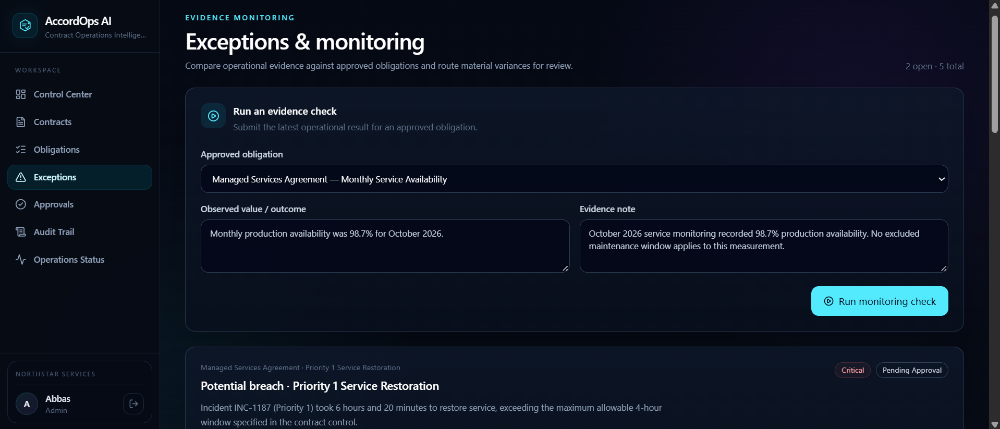

Approved obligations can be evaluated against real operational evidence. The monitoring form captures the observed result and supporting note before the evidence enters the compliance evaluation flow.

### Exception Detection

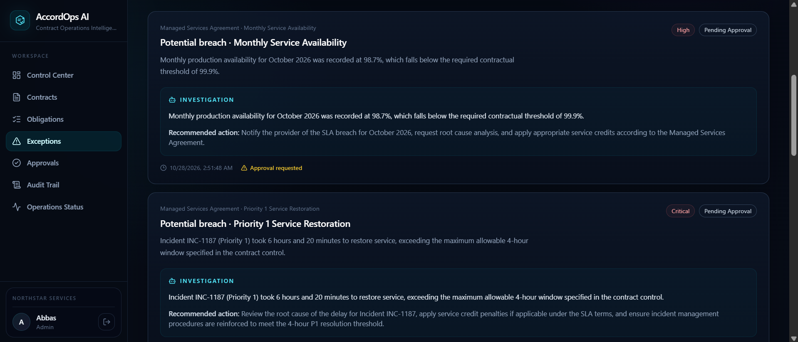

When evidence falls outside an approved contractual requirement, AccordOps creates a traceable exception containing the affected obligation, severity, finding, evidence context, and current state.

### Human Approval Gate

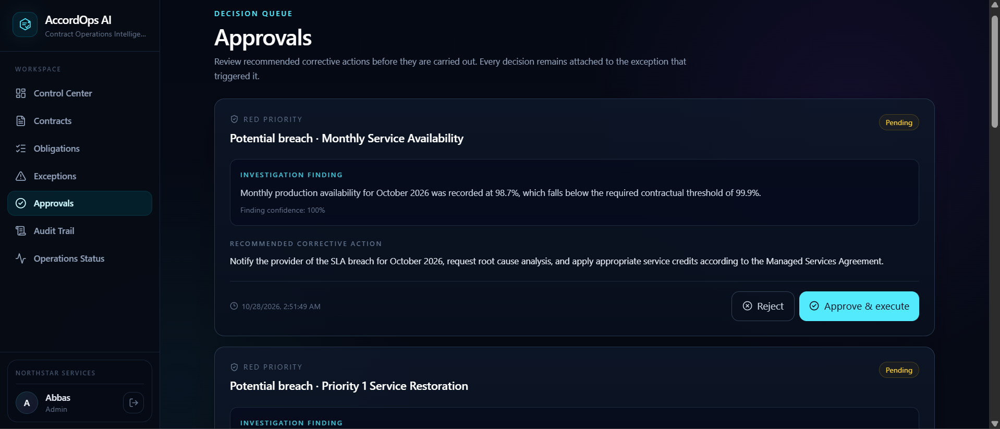

Recommended corrective action is presented for human review before execution. The reviewer can approve or reject the action instead of allowing AI to trigger remediation autonomously.

### Approved Remediation

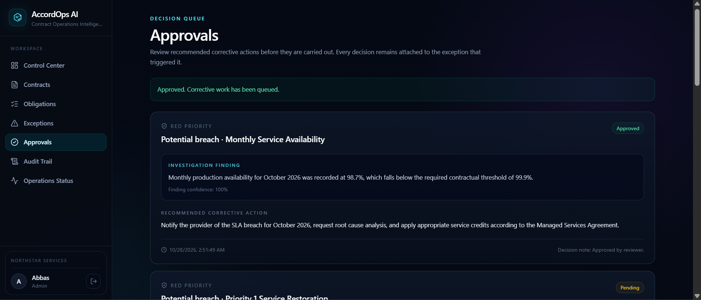

Once approved, the corrective action can move into the automation layer. AccordOps retains the decision and resulting execution state as part of the operational history.

### Operational Overview

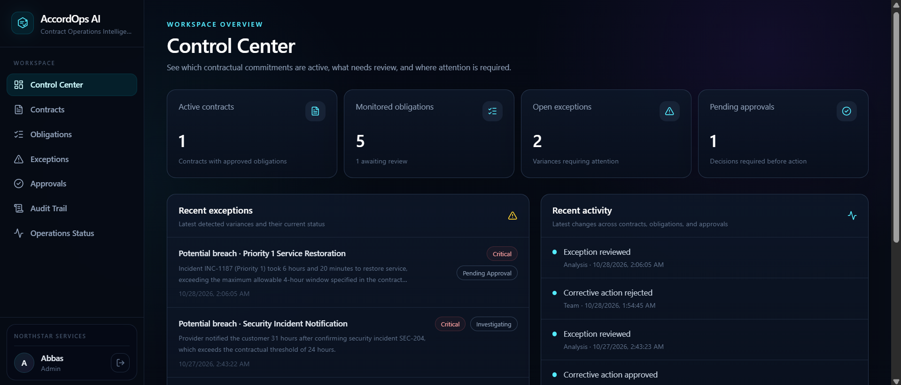

The Control Center summarizes active contracts, monitored obligations, current exceptions, pending decisions, recent exceptions, and recent operational activity.

### Operations Status

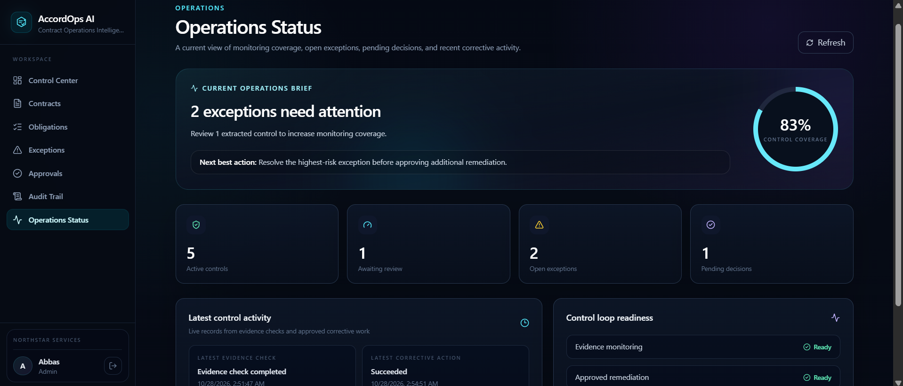

Operations Status provides a focused view of monitoring coverage, review workload, open issues, pending decisions, and recent corrective activity.

### Audit Trail

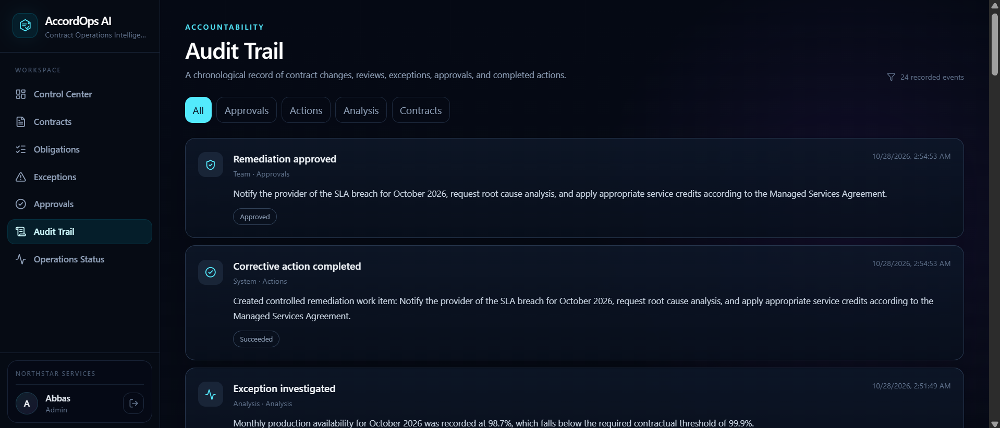

Important events are recorded in sequence, including contract ingestion, obligation extraction and review, monitoring outcomes, exception handling, approval decisions, and remediation results.

### Product Experience

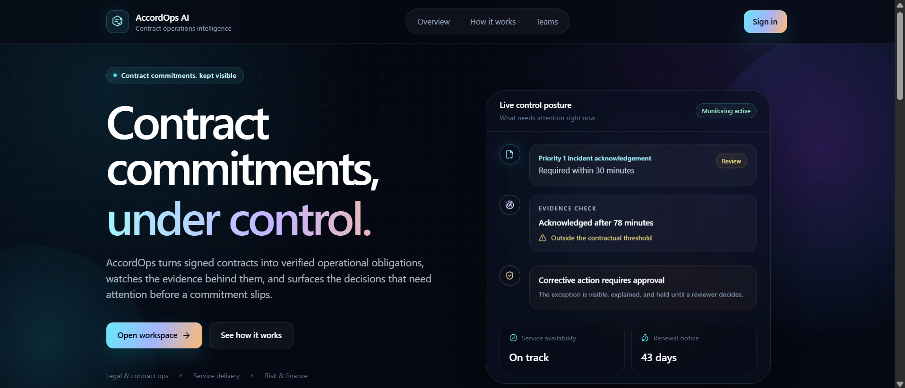

The landing experience introduces AccordOps as an operational control platform rather than only a contract-analysis tool, with the product flow centered on obligations, evidence, decisions, and action.

---

## 🤖 Automation & AI Architecture

### AI Layer

Gemini is used as an intelligence layer inside the workflow rather than as an unrestricted decision-maker.

Its role includes:

- extracting structured obligations from contract content,
- interpreting operational evidence against approved requirements,
- supporting exception investigation,
- and recommending corrective actions for review.

The system keeps AI outputs connected to source evidence and structured application state. Human review remains part of the process before candidate obligations become active controls and before corrective actions are executed.

### n8n Automation

AccordOps uses two n8n workflows for the operational monitoring and remediation paths.

#### Operational Evidence Monitor

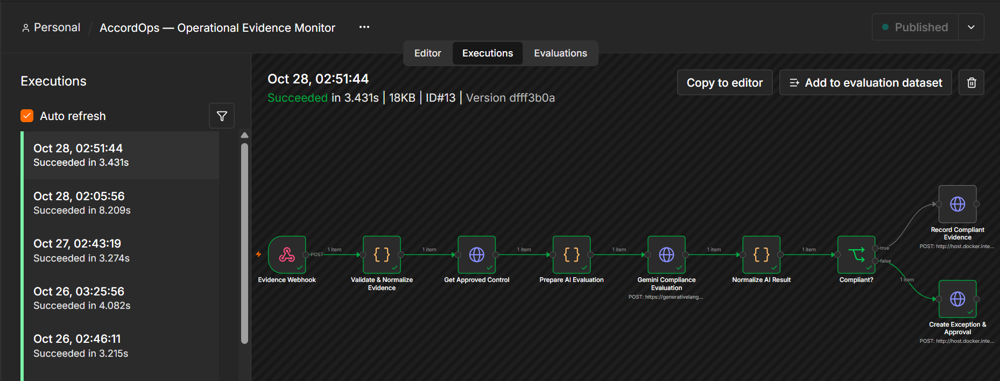

The evidence-monitoring workflow receives operational evidence, validates the request, loads the approved control, prepares the evaluation context, runs the AI compliance check, normalizes the result, and branches based on compliance.

```text
Evidence
   ↓
Validation
   ↓
Approved Control Lookup
   ↓
AI Evaluation
   ↓
Normalized Result
   ↓
Compliance Decision
   ↓
Exception / Approval Creation
```

#### Approved Remediation

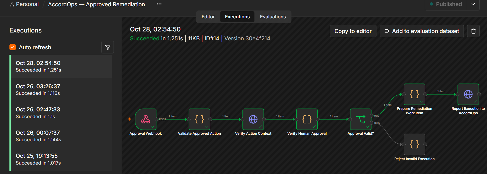

The remediation workflow verifies the action context and human approval state before preparing and executing corrective work. The execution result is then reported back to AccordOps.

```text
Approved Action
      ↓
Context Validation
      ↓
Human Approval Verification
      ↓
Remediation Preparation
      ↓
Execution
      ↓
Result Returned to AccordOps
```

---

## 🏗️ System Architecture

```text
┌──────────────────────────────┐
│        Next.js Frontend      │
│  Contracts • Controls • UI   │
└──────────────┬───────────────┘
               │
               ▼
┌──────────────────────────────┐
│        FastAPI Backend       │
│ Auth • Business Logic • APIs │
└──────────────┬───────────────┘
               │
               ▼
┌──────────────────────────────┐
│           Supabase           │
│ Auth • PostgreSQL • Storage  │
└──────────────┬───────────────┘
               │
        ┌──────┴──────┐
        ▼             ▼
┌─────────────┐  ┌─────────────┐
│   Gemini    │  │     n8n     │
│ AI Analysis │  │ Automation  │
└──────┬──────┘  └──────┬──────┘
       │                │
       └────────┬───────┘
                ▼
┌──────────────────────────────┐
│ Operational Decisions &      │
│ Controlled Corrective Action │
└──────────────────────────────┘
```

The frontend provides the product experience, while FastAPI handles authenticated business operations and coordinates application state. Supabase provides authentication, PostgreSQL persistence, and private contract storage. Gemini supports the intelligence layer, and n8n handles the automation paths that connect monitoring and approved remediation back into the operational workflow.

---

## 🛠️ Technology Stack

| Layer | Technology | Purpose |
|---|---|---|
| Frontend | Next.js 16, TypeScript, Tailwind CSS | Responsive product interface |
| Backend | FastAPI, Python | APIs, validation, and business logic |
| Database | Supabase PostgreSQL | Contracts, obligations, exceptions, approvals, actions, and audit data |
| Authentication | Supabase Auth | Secure user authentication and session handling |
| Storage | Supabase Storage | Private contract document storage |
| AI | Google Gemini | Obligation extraction, compliance interpretation, and investigation support |
| Automation | n8n | Evidence monitoring and approval-gated remediation |
| Document Processing | `pypdf`, `python-docx` | PDF and DOCX contract parsing |
| Containers | Docker | Local automation environment and service orchestration |
| Frontend Validation | Next.js / ESLint / TypeScript | Build and code validation |
| Backend Testing | Pytest | Backend service and AI logic tests |

---

## 🧪 Testing & Validation

AccordOps was tested across the complete operational-control lifecycle rather than only at the UI level.

Validation covered:

- authenticated contract upload,
- PDF/DOCX document processing,
- AI obligation extraction,
- candidate review and approval,
- evidence submission,
- compliant and non-compliant monitoring outcomes,
- exception creation,
- AI-supported investigation,
- approval and rejection paths,
- approval-gated remediation,
- dashboard and status updates,
- and audit-event creation.

One tested example used the **Monthly Service Availability** obligation:

| Control | Value |
|---|---|
| Contract requirement | `99.9%` monthly production availability |
| Observed result | `98.7%` |
| Expected outcome | Potential variance detected |
| System result | Exception created and routed through the review workflow |

Additional monitoring scenarios were tested against obligations such as Priority 1 incident acknowledgment, Priority 1 service restoration, security incident notification, and customer-data return.

Detailed validation guidance is available in [`docs/VALIDATION.md`](docs/VALIDATION.md).

---

## 🚀 Running AccordOps

### Prerequisites

Before running the project locally, make sure the environment includes:

- Node.js
- Python 3.11+
- Docker Desktop
- a Supabase project
- Gemini API access
- n8n credentials/configuration used by the local workflows

### Environment Setup

The repository includes environment examples for the required services. Keep real credentials in local environment files and never commit them to Git.

Detailed setup instructions are available in:

- [`docs/FINAL_SETUP.md`](docs/FINAL_SETUP.md)
- [`docs/N8N_SETUP.md`](docs/N8N_SETUP.md)
- [`docs/VALIDATION.md`](docs/VALIDATION.md)

### Start the Application

From the project root:

```powershell
cd G:\Projects\AccordOps_AI
powershell -ExecutionPolicy Bypass -File .\scripts\start-all.ps1
```

The local application uses:

```text
Frontend:     http://localhost:3000
Backend API:  http://localhost:8000
API Docs:     http://localhost:8000/docs
n8n:          http://localhost:5678
```

Run the project validation script with:

```powershell
powershell -ExecutionPolicy Bypass -File .\scripts\validate.ps1
```

---

## 🔐 Security & Data Handling

AccordOps was designed so operational control does not depend on exposing sensitive contract or application data.

The implementation includes:

- authenticated application routes,
- organization-scoped application records,
- Supabase Row Level Security policies,
- private contract storage,
- environment-based secrets,
- no API keys or credentials stored in the repository,
- document hashing for ingestion integrity,
- human review before extracted obligations become active controls,
- and human approval before corrective automation is allowed to execute.

The repository uses sample/demo contract data for development and portfolio demonstration. Secrets, private credentials, production customer data, and external-service tokens are intentionally excluded.

---

## 👤 Author

**Muhammad Abbas**  
Software Engineer • AI Automation Engineer

[GitHub](https://github.com/MdAbbas762)
